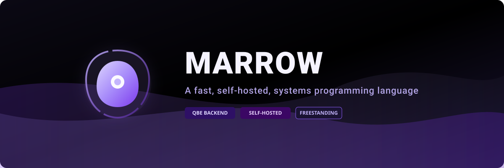
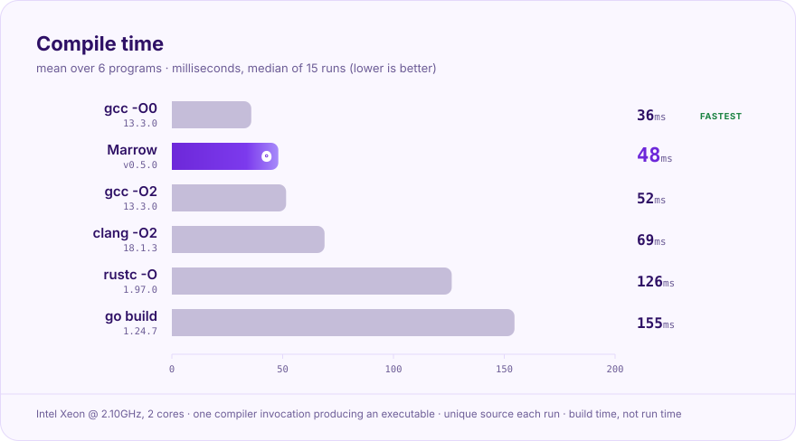
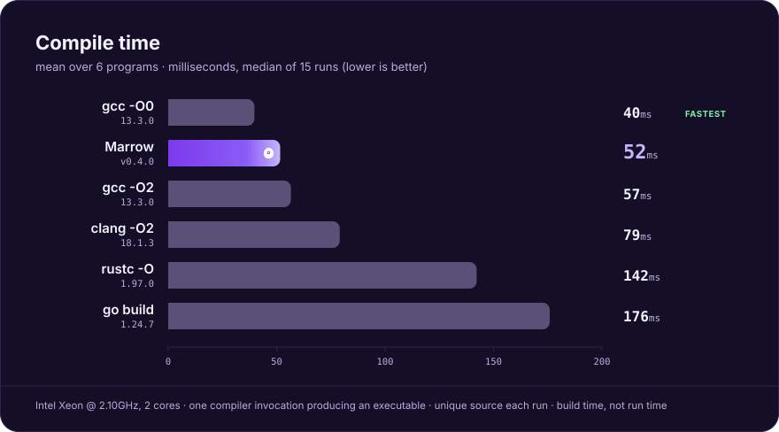

<p align="center">
  <b>A small, fast, self-hosted systems language with checked memory and no runtime.</b>
</p>

<p align="center">
  <a href="https://zuygui.github.io/marrow/">Documentation</a> ·
  <a href="https://zuygui.github.io/marrow/getting-started/installation/">Install</a> ·
  <a href="CHANGELOG.md">Changelog</a> ·
  <a href="https://github.com/zuygui/marrow/releases/latest">Latest release</a>
</p>

> [!IMPORTANT]
> Marrow is under active development and is not ready for production use. Current release: **v0.5.0 "Differentiation"**.

## Install

```sh
curl -fsSL https://raw.githubusercontent.com/zuygui/marrow/main/install.sh | sh
```

This installs `marrow`, `qbe` and the standard library to `~/.marrow`. You also need a C compiler (`marrow doctor` checks your setup). Other platforms and building from source: [installation guide](https://zuygui.github.io/marrow/getting-started/installation/).

## A taste of Marrow

```marrow
@import("std/std.mw")

fn sum(v: &VecI64) -> i64 {
    var total: i64 = 0;
    var i: i64 = 0;
    while (i < v.len) {
        total = total + vec_i64_get(v, i);
        i = i + 1;
    }
    ret total;
}

@export fn main() {
    var v: ^VecI64 = vec_i64_new(8);
    vec_i64_push(v, 40);
    vec_i64_push(v, 2);
    print_i64(sum(v));
    println("");
}                      // v is freed here, automatically
```

```console
$ marrow sum.mw
Compilation successful! Executable created at: sum
$ ./sum
42
```

`^T` owns a value and frees it at the end of its scope; `&T` and `&mut T` borrow. Using a value after it moved is a compile error, not a crash:

```text
error[E0420]: use of moved value `v`
 --> bad.mw:8:18
  |
7 |     eat(v);
  |         - value moved here
8 |     vec_i64_push(v, 1);
  |                  ^ this value was handed over and is no longer here
```

## Methods and inheritance

```marrow
@import("std/std.mw")

struct Animal {
    legs: i64;
    age: i64;
}

impl Animal {
    fn new(legs: i64, age: i64) -> Animal { ret Animal { legs: legs, age: age }; }
    fn birthday(&mut self) { self.age += 1; }
}

struct Dog : Animal {
    tricks: i64;
}

impl Dog {
    fn new(tricks: i64) -> Dog { ret Dog { base: Animal::new(4, 2), tricks: tricks }; }
}

fn age_of(a: &Animal) -> i64 { ret a.age; }

@export fn main() {
    var d: Dog = Dog::new(3);
    d.birthday();                    // inherited method
    print_i64(age_of(&d));           // &Dog converts to &Animal
    println("");
}
```

`impl` blocks hold associated functions; `&self`, `&mut self` and `^self` borrow or consume the receiver. `struct Dog : Animal` places `base: Animal` first, so inherited fields and methods work on the child and a child can hide a parent's method. Calls are resolved at compile time, with no hidden vtable.

## Why Marrow?

**Bone marrow** is the living matrix deep inside bones, where the cells the whole organism depends on are made. Marrow aims to be that kind of foundation for software: close to the metal, with no heavy runtime in between.

- **Checked memory, no runtime.** Owners (`^T`) are freed automatically and moves are checked; borrows (`&T`, `&mut T`) follow block lifetimes. Raw pointers (`*T`, `raw x`) remain available inside `unsafe` blocks and `@trusted` functions. No garbage collector, no hidden allocation.
- **Self-hosted.** The compiler is written in Marrow (`compiler/marrow.mw`) and bootstraps to a fixed point. The original Rust compiler lives on the [`v1`](https://github.com/zuygui/marrow/tree/v1) branch.
- **QBE backend.** Marrow emits [QBE](https://c9x.me/compile/) IL, then assembles and links with your system C compiler.
- **Libc-free standard library.** Files, directories, sockets, HTTP/HTTPS with TLS 1.3, hashing and ciphers, big integers, RSA/ECDSA, JSON, time, async tasks, all written in Marrow on a small platform layer.
- **Methods and single inheritance**, resolved statically, zero cost.
- **One binary, whole toolchain.** `marrow build`, `run`, `check`, `test`, `fmt`, `doc`, `lsp`, a package manager and a registry.
- **Clear diagnostics.** Rust-style errors with snippets, labels, notes and suggestions.

## Compile time

<p align="center">
  
  
</p>

Time for one compiler invocation to turn the same program into a native executable (median of 15 runs, unique source each run so nothing is cached), in milliseconds, lower is better:

| Program | Marrow | gcc -O0 | gcc -O2 | clang -O2 | rustc -O | go build |
| --- | ---: | ---: | ---: | ---: | ---: | ---: |
| Recursive Fibonacci | 45 | **32** | 60 | 63 | 106 | 150 |
| Sieve of Eratosthenes, 5M | 45 | **38** | 52 | 67 | 130 | 156 |
| Longest Collatz chain below 1M | 46 | **35** | 37 | 59 | 106 | 149 |
| Mandelbrot, 400x400, f64 | 47 | **31** | 43 | 66 | 115 | 156 |
| Quicksort of 1M integers | 59 | **42** | 58 | 84 | 157 | 153 |
| 200x200 matrix product, f64 | 46 | **37** | 59 | 76 | 144 | 163 |

Marrow is not the fastest here: `gcc -O0` beats it on every program. It lands close to `gcc -O2`, ahead of `clang -O2`, and two to three and a half times quicker than `rustc` and `go build`. These are small programs on a 2-core VM, and about 45 ms of Marrow's time is `qbe` plus the system assembler and linker.

And the speed of the programs it produces (run time, median of 7 runs, milliseconds):

| Program | Marrow | gcc -O0 | gcc -O2 | clang -O2 | rustc -O | go build |
| --- | ---: | ---: | ---: | ---: | ---: | ---: |
| Recursive Fibonacci | 76 | 80 | **20** | 32 | 32 | 57 |
| Sieve of Eratosthenes, 5M | 28 | 54 | **24** | 26 | 30 | 29 |
| Longest Collatz chain below 1M | 504 | 462 | 239 | **170** | 185 | 315 |
| Mandelbrot, 400x400, f64 | 20 | 28 | **13** | **13** | 13 | 16 |
| Quicksort of 1M integers | 134 | 175 | 108 | **105** | 109 | 112 |
| 200x200 matrix product, f64 | 8 | 23 | 7 | **4** | 4 | 8 |

The code QBE generates is about as fast as `gcc -O0` (mean 128 ms against 137 ms) and well behind optimizing compilers such as `rustc` (62 ms): no inlining, no loop optimizations. Closing that gap is on the roadmap. Method, versions and caveats: [`benchmarks/`](benchmarks/README.md) (reproduce with `python3 benchmarks/run.py --exec`).

## How it works

```text
 source (.mw) ─▶ Lexer ─▶ Parser ─▶ Imports ─▶ Check ─▶ Codegen ─▶ QBE ─▶ cc ─▶ executable
                                  (modules,    (types,   (QBE IL)
                                   generics)   ownership,
                                               borrows)
```

Each stage is its own file in [`compiler/`](compiler/). The compiler is built from checked-in assembly seeds, so only `cc` and `qbe` are needed to bootstrap it.

## Platforms

Linux (x86_64, aarch64, riscv64) is the reference platform; macOS and Windows layers exist and are experimental. Only Linux x86_64 is exercised end to end.

## Building from source

```sh
./bootstrap.sh           # seed -> stage 1 -> stage 2, writes build/marrow
tests/diag.sh            # golden diagnostics
tests/run.sh             # end-to-end programs
```

`bootstrap.sh --update-seed` regenerates `bootstrap/seed-*.s.gz` after the compiler changes. See [CONTRIBUTING.md](CONTRIBUTING.md).

## Contributors

<p align="center">
  
</p>

MIT licensed.
